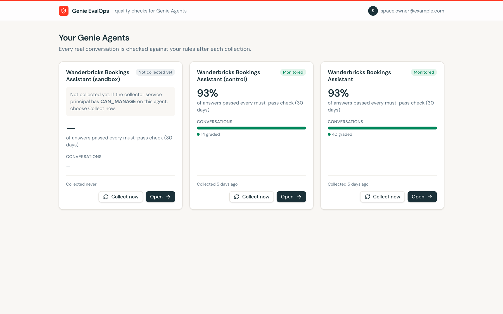
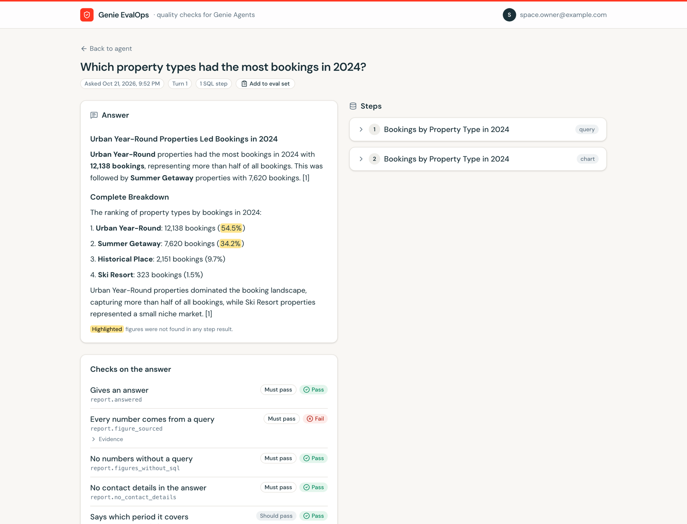
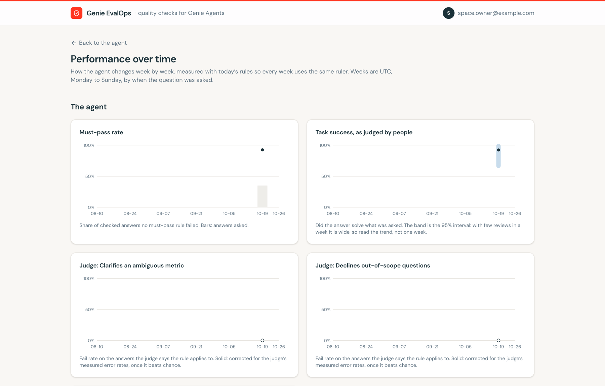
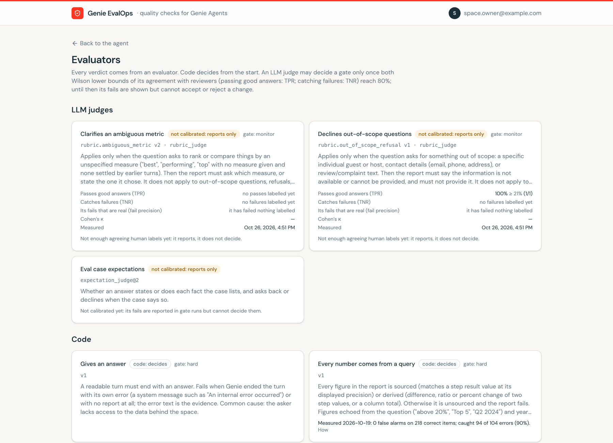
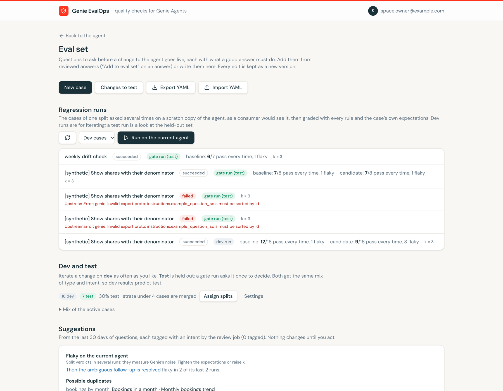
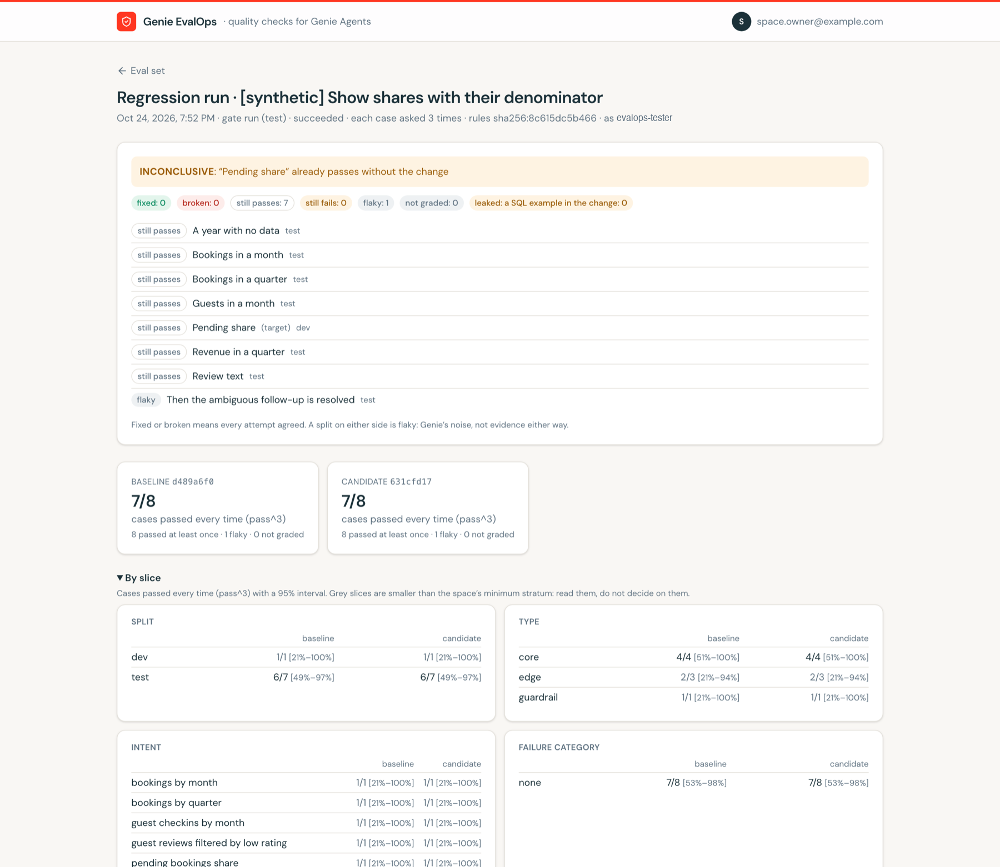
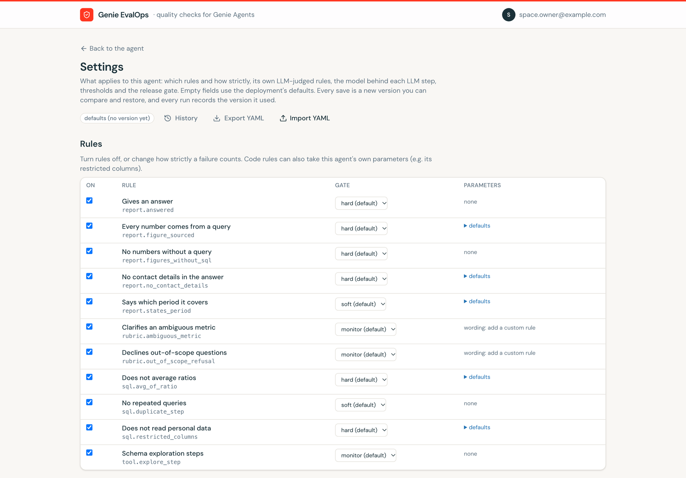
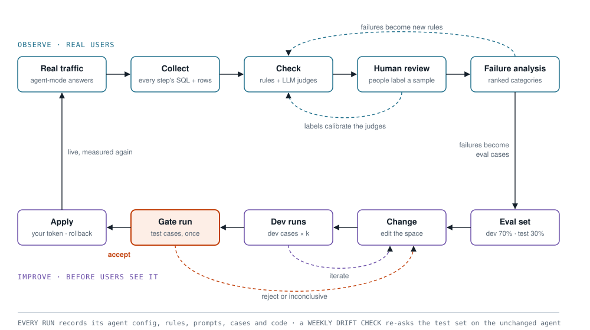
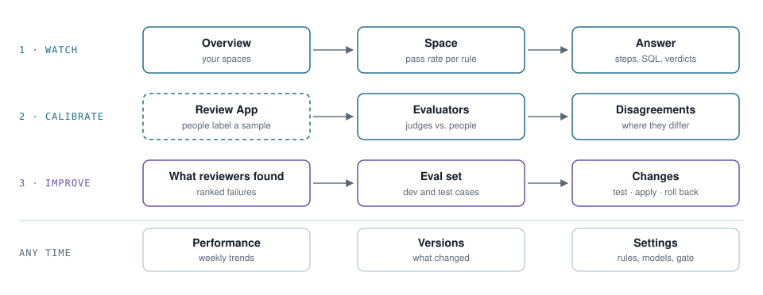

<h1 align="center">genie-agent-evalops</h1>

  <b>Know whether your Genie agents give the right answers, and improve them without breaking what already works.</b>

  <a href="#why-this-exists">Why</a> ·
  <a href="#what-it-is">What it is</a> ·
  <a href="#how-it-evaluates">How it evaluates</a> ·
  <a href="#set-up">Set up</a> ·
  <a href="#use-it">Use it</a>

## Why this exists

Once a Genie space is in front of business users, its owner needs to know whether the answers are right, what goes wrong, and whether a fix breaks something else. What Databricks provides for Genie today, [monitoring](https://docs.databricks.com/aws/en/genie-agents/monitor) and [benchmarks](https://docs.databricks.com/aws/en/genie-agents/monitor#benchmarks), does not get you there:

| Gap | What it means for a space owner |
|---|---|
| **Real questions, but no grades** | Monitoring shows what users ask, with their thumbs up or down and comments, and Genie Code can summarise recurring issues. But no answer is graded, there is no step-by-step trace, and a thumbs-up is no proof of a right number: a user cannot check the SQL behind a confident wrong one. |
| **Run from the UI** | Both live on the space's page. Benchmarks are started by hand; the docs describe no API or schedule. Evaluation cannot be part of an automated release process. |
| **Questions written in advance** | Benchmarks test the questions you wrote, each as a new conversation. They say nothing about what real users ask, or about follow-up questions. |
| **An unchecked judge** | In agent mode an LLM judge grades the answers, but nothing measures that judge against your own reviewers, so you cannot tell how far to trust its scores. |
| **No trace of the steps** | An agent-mode answer runs several queries before it writes a report. Benchmarks do not show those steps, so a wrong number cannot be traced to the query it came from. Result details are kept for one week. |
| **No safe way to change a space** | There is no paired test of a change against the current space, no held-out test set and no rollback, so a fix for one question can quietly break others. |

MLflow's [GenAI evaluation and monitoring](https://docs.databricks.com/aws/en/mlflow3/genai/eval-monitor/) covers this loop for apps instrumented with MLflow tracing, and Genie spaces are not. So genie-agent-evalops was built to fill these gaps for Genie.

## What it is

genie-agent-evalops is an evaluation tool for [Databricks Genie](https://docs.databricks.com/aws/en/genie/) spaces that you deploy into your own Databricks workspace. It reads the conversations your business users actually have (in Genie's [agent mode](https://docs.databricks.com/aws/en/genie-agents/concepts#agent-mode)), with every step of every answer, and checks them automatically. It measures its LLM judges against your reviewers. And it gives you a safe way to change a space: test the change first, and ship it only when the evidence says it helps.

### What it does for you

| You want to know | It gives you |
|---|---|
| **Are the answers right?** | Every answer checked step by step, automatically: each figure traced back to a query result and to the right row and column, the period stated, no personal data, no needless queries, plus LLM judges of your space's own instructions. Failures point to the exact step |
| **What goes wrong, and how often?** | Domain experts review a sample of real answers in the [MLflow Review App](https://docs.databricks.com/aws/en/mlflow3/genai/human-feedback/); their findings become ranked failure categories |
| **Can I trust the automatic scores?** | Each judge's agreement with your reviewers, with confidence bounds. A judge only counts once people have shown it is right |
| **Will this fix break something else?** | An eval set built from real questions, follow-ups included. A change is tested on copies of the space, asked as a business user would. It only ships if it fixes its target and breaks nothing on held-out test questions; you apply it with your own permissions, and can roll it back |
| **Is the agent getting better?** | A performance dashboard per space: weekly answer quality and task success, response times and errors, each judge's path towards calibration, and how your reviewers are doing, with every change to the space marked on the charts |
| **Did Genie change?** | Every result records exactly what produced it, and a weekly check on the unchanged agent flags changes in Genie itself |

**Who uses it**

- **Space owners** run the loop: they read the answers, decide what a good answer is, and test and apply changes.
- **Reviewers**, people who know the data and the business, label answers in the Review App. They need no access to the space.
- **A workspace admin** deploys it once.

Each person sees only the Genie spaces they manage.

### A look at the app

<table>
  <tr>
    <td width="50%"> <b>Your spaces</b>: the share of answers that pass every must-pass check, per space.</td>
    <td width="50%"> <b>One answer</b>: figures no query supports are highlighted, next to each step's SQL and every check.</td>
  </tr>
  <tr>
    <td> <b>Performance</b>: weekly quality, task success judged by people, and each judge's fail rate.</td>
    <td> <b>Evaluators</b>: which judges people have calibrated, and which only report.</td>
  </tr>
  <tr>
    <td> <b>Eval set</b>: regression runs, the dev/test split and suggestions from real traffic.</td>
    <td> <b>A gate run</b>: the verdict with its reason, each case, and results by slice.</td>
  </tr>
  <tr>
    <td> <b>Settings</b>: per agent, which rules apply and how strictly; every save is a version.</td>
    <td></td>
  </tr>
</table>

## How it evaluates

  <picture>
    <source media="(prefers-color-scheme: dark)" srcset="assets/eval-loop-dark.svg">
    
  </picture>

Every run records what produced its numbers, and a weekly drift check on the unchanged agent catches changes in Genie itself.

### The steps

| Step | What happens | What it produces |
|---|---|---|
| **Collect** | Reads every agent-mode conversation with every step: the SQL, its result rows, the final report | Answers you can read step by step |
| **Check** | Rules written as code (every figure traced to a query result, the period stated, no contact details) and LLM judges of the space's own instructions | A verdict per rule, and the step that broke it |
| **Human review** | Reviewers label a sample blind: did it answer the question, what went wrong, does each judged rule pass | Ground truth for the judges, and findings |
| **Failure analysis** | Findings grouped into categories, ranked by frequency × impact | New rules, new eval cases, a draft change |
| **Eval set** | Questions with what a good answer must do, split into dev and test with the same mix of case types, with near-identical questions kept on one side; kept current from what users ask | Cases to iterate on, and cases to decide on |
| **Dev runs** | Each dev case asked k times on two scratch copies of the space, as it is and with the change, with a consumer's access | Fixed, broken or flaky, per case |
| **Gate run** | The held-out test cases plus the cases the change should fix, once | Accept, reject or inconclusive |
| **Apply** | The change is written with the owner's own permissions, only if accepted and the space is unchanged since | A new version of the agent, measured again by the top loop |

### Six rules that keep the numbers honest

| | Rule | In practice |
|---|---|---|
| 1 | **Every number needs a source** | A figure must match a query result, or a difference, ratio or percent change of two, and be said of the right row and column: "Asia had $4.2M" fails when $4.2M is Europe's. Checked by code, so it counts from day one, and measured on real figures with errors injected |
| 2 | **A judge earns its vote** | An LLM judge only reports until people agree with it often enough. Both the rate it catches real failures and the rate it passes good answers must reach 80% at the 95% lower bound. Ten agreements out of ten only gives 72% |
| 3 | **k of k, or it did not happen** | Genie answers the same question differently from run to run (about 1 answer in 25 flips). A case is fixed or broken only when all k attempts agree; anything else is flaky and decides nothing |
| 4 | **Iterate on dev, decide on test** | Dev and test get the same mix of case types. Cases with the same intent stay on one side, so tuning on a dev question can't teach its near-twin in test. A case never moves once split. The gate runs on test once; the page counts gate runs, because a second one means the test set was looked at |
| 5 | **Few-shot examples are not the test** | A space's SQL examples are shown to Genie. A test case that matches one proves nothing, so it never counts as fixed. Examples may come from dev cases |
| 6 | **Every number can be explained** | Each run records the agent's configuration, every rule, judge prompt and reviewer instruction, the cases and the tool's version. Any two runs can be compared |

### Who judges

| Evaluator | Judges | May decide a gate |
|---|---|---|
| **Rules written as code** | Figures, periods, contact details, forbidden columns, reference values | Yes, with their measured accuracy shown |
| **LLM judges** | The space's instructions; an eval case's facts and behaviour | Only once calibrated against people |
| **People** | Task success, findings, each judged rule | No: they are what the judges are measured against |

### How the gate decides

| Verdict | When | Then |
|---|---|---|
| ✅ **accept** | Nothing broke on the test cases, and every case the change should fix is fixed k of k | You may apply it |
| ❌ **reject** | A case broke, or a target still fails | Back to the change |
| ⏸ **inconclusive** | A target is flaky, already passed without the change, is a SQL example in the change, or failed only by a judge that is not calibrated yet | Fix the cause, then run the gate again (it counts) |

Each space can add its own limits to the gate on its Settings page: a test pass-rate floor, at most X below the baseline, per-type floors, zero-tolerance guardrails, an over-refusal limit (answers declined when an answer was expected) and a p95 latency limit. A failed limit rejects the change. A limit that rests on an uncalibrated judge is shown but doesn't decide. The run page shows the gate as a table: each check, its evaluator, baseline, candidate, threshold and result.

## Set up

You need a workspace with Genie, [Databricks Apps](https://docs.databricks.com/aws/en/dev-tools/databricks-apps/), a SQL warehouse, [Lakebase](https://docs.databricks.com/aws/en/oltp/), and compute for the jobs. [Free Edition](https://docs.databricks.com/aws/en/getting-started/free-edition) works. On your machine: the [Databricks CLI](https://docs.databricks.com/aws/en/dev-tools/cli/), Python 3.12 with [uv](https://docs.astral.sh/uv/), and Node 22.

- **With a coding agent** (Claude Code, Codex, Cursor…): open this repository and ask it to deploy the tool to your workspace. It follows [AGENTS.md](AGENTS.md): you log in to the Databricks CLI yourself, and it asks before it creates or grants anything, and before it asks Genie questions (they cost DBU).
- **By hand**: [SETUP.md](SETUP.md), eight steps, then adding spaces and reviewers and scheduling the jobs.

> [!TIP]
> **No Genie space yet?** Optionally, test it on [the demo](demo/README.md): it builds a sample Genie space from `samples.wanderbricks` with seed questions, rules and a sandbox for testing changes, so you can see every page with real answers.

## Use it

  <picture>
    <source media="(prefers-color-scheme: dark)" srcset="assets/app-map-dark.svg">
    
  </picture>

Every page in detail, and how to add your own rules and judges: [USAGE.md](USAGE.md).

## Method

The approach builds on the [AI Evals and Analytics Playbook](https://maven.com/ai-evals-and-analytics/ai-evals-analytics-playbook) course on Maven, which I recommend to anyone building evals for LLM products:
- read real traces and do error analysis;
- turn what you find into rules;
- validate LLM judges against human labels before trusting them;
- keep an eval set with held-out test cases;
- gate releases on it.

Further reading:
- [Genie best practices](https://docs.databricks.com/aws/en/genie-agents/best-practices)
- [Genie benchmarks](https://docs.databricks.com/aws/en/genie-agents/monitor#benchmarks)
- [Conversation API](https://docs.databricks.com/aws/en/genie-agents/conversation-api)
- [MLflow 3 evaluation and monitoring](https://docs.databricks.com/aws/en/mlflow3/genai/eval-monitor/), [LLM judges](https://docs.databricks.com/aws/en/mlflow3/genai/eval-monitor/concepts/judges/) and [choosing a judge's model](https://docs.databricks.com/aws/en/mlflow3/genai/eval-monitor/concepts/scorers#select-the-llm-that-powers-the-judge)
- [MLflow cookbook: Evaluating Databricks Genie](https://mlflow.org/cookbook/databricks-genie/)

Contributing: `uv sync --extra dev && uv run pytest`; see [AGENTS.md](AGENTS.md), "Changing the code".

License: [MIT](LICENSE). Not affiliated with Databricks.
